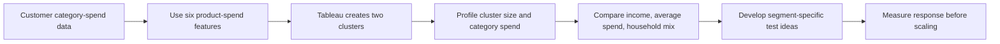
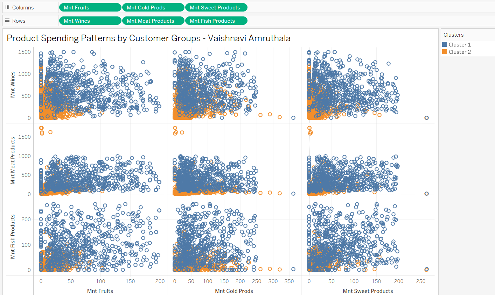
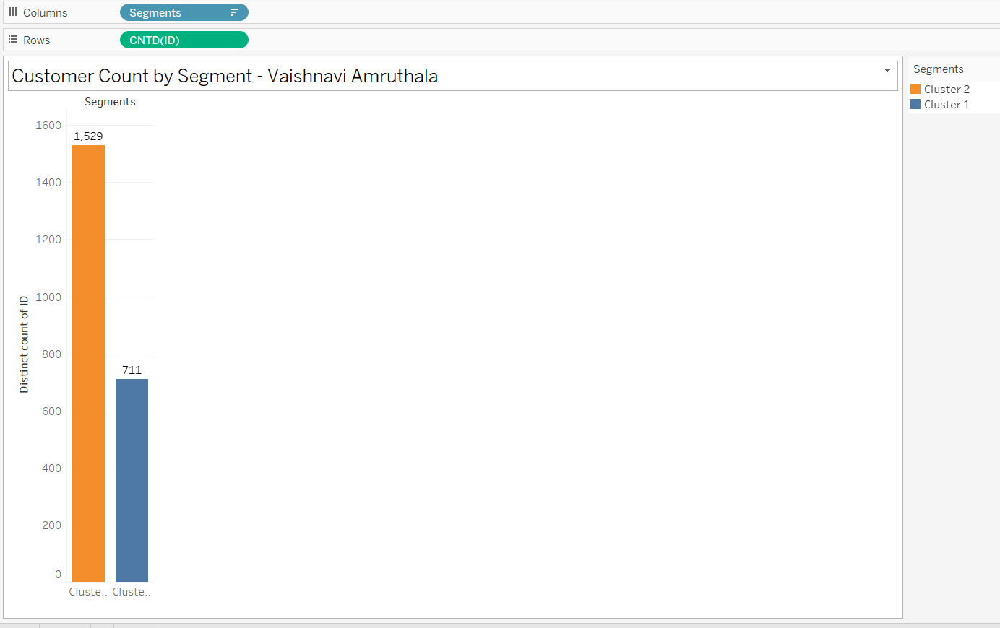
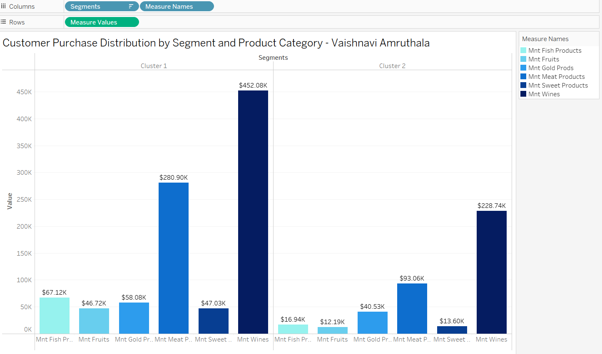
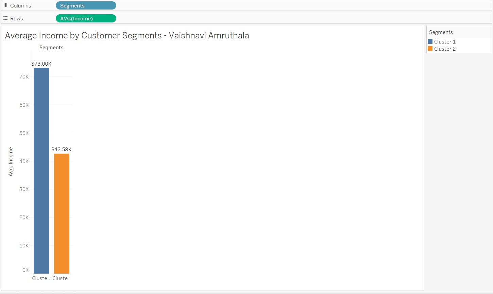
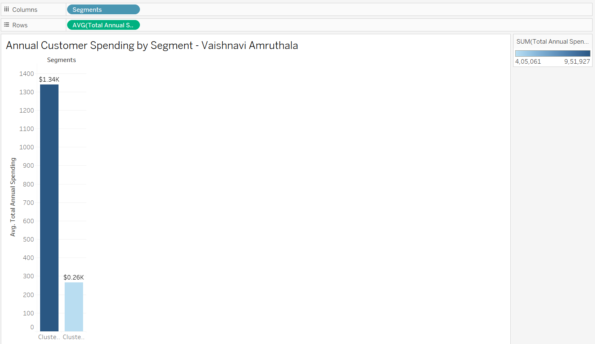
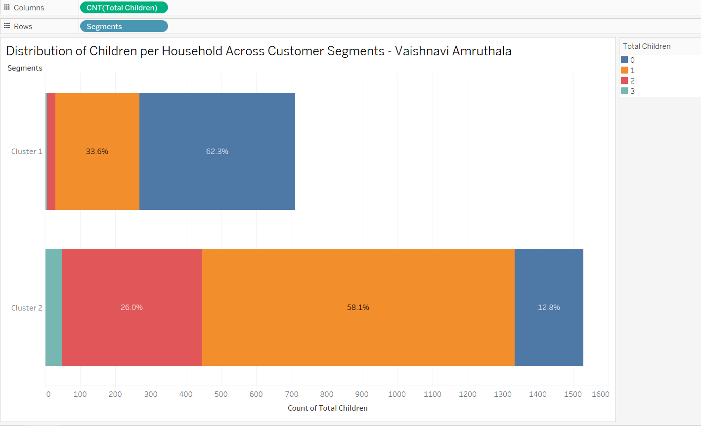

# Customer Segmentation & Profiling

**Positioning:** Customer Analytics | Tableau clustering and segment profiling

## Executive summary

Tableau grouped **2,240 customers into two clusters** using spending across six product categories. Cluster 1 is smaller (711 customers) and has higher reported average annual spend and income; Cluster 2 is larger (1,529 customers). These profiles can inform testable retention and growth strategies.

## Business question and pipeline

How can customers with different product-spending patterns be grouped and profiled to guide focused marketing decisions?

## Business KPIs

| Metric | Formula / definition | Reported value | Interpretation |
|---|---|---:|---|
| Customers profiled | Count of customer records | **2,240** | Total represented in the report’s cluster-size chart. |
| Cluster 1 size/share | `711 ÷ 2,240`; share = cluster customers ÷ all customers × 100 | **711 / 31.7%** | Smaller segment. |
| Cluster 2 size/share | `1,529 ÷ 2,240`; share = cluster customers ÷ all customers × 100 | **1,529 / 68.3%** | Larger segment, more than twice Cluster 1 by count. |
| Average annual spend per customer | Reported average by cluster | **C1: $1,340; C2: $260** | C1 averages about **5.15×** C2 (`1,340 ÷ 260`). The report does not provide a detailed aggregation formula or period validation. |
| Average annual income | Reported average by cluster | **C1: $73K; C2: $42.58K** | C1 has a higher reported average; income is descriptive and does not establish the cause of spending differences. |
| Category spend | Reported spend by category and cluster | **C1 wine: $457.08K; C1 meat: $290.90K; C2 wine: $226.76K** | Wine is a leading category in both clusters; the report’s chart is a cluster-level total, distinct from average spend per customer. |
| Household composition | Share within each cluster by number of children | **C1: 62.3% none, 33.6% one; C2: 12.8% none, 58.1% one, 26.0% two, 3.1% three** | C2 has a larger share of households with children in the reported breakdown. |

## Model Metrics

| Metric | Method / formula | Reported value | Interpretation |
|---|---|---:|---|
| Number of clusters | Tableau-generated clustering result | **2** | Two groups created using spending across six product categories; this is an output, not a measure of cluster quality. |
| Cluster quality / stability | Silhouette, inertia, or repeat-run stability | Not reported | The report does not quantify separation or repeatability; validate before operational use. |
| Predictive performance | Accuracy, precision/recall, or RMSE | Not applicable | This is unsupervised segmentation, not supervised prediction. |

## Findings and recommendations

- **Cluster 1:** Smaller, with higher reported income and average spend; consider testing retention or premium offers with this segment.
- **Cluster 2:** Larger, with lower reported average spend; test category bundles or value offers and measure incremental spend.
- Spending profiles vary across the six product categories; use category preferences to tailor test offers, then compare response and margin by cluster.
- Treat the cluster labels as descriptive, not inherently “high value” or causal. Confirm the clustering settings and refresh stability before operational use.

## Selected Tableau charts

### Spending patterns across six categories

### Customer count by cluster

### Category spend by cluster

### Average income and average spending

### Household composition

## Evidence and proposed structure

The charts above are extracted from **BI Homework Assignment 7 – Vaishnavi Amruthala**. The report describes Tableau’s two-cluster result but does not provide the Tableau workbook, source dataset, or exact clustering settings. No raw customer data or workbook is included yet.

Proposed repository: `README.md`, `assets/` (selected report charts), `workbook/` (verified Tableau workbook when available), and `data/` (only approved public data or aggregates).

## Supporting documents

- [Executive summary](docs/Executive-Summary.md)
- [Business requirements summary](docs/BRD-Summary.md)
- [Functional requirements summary](docs/FRD-Summary.md)

The source reports do not document an existing-state (As-Is) process; none is presented as fact.

